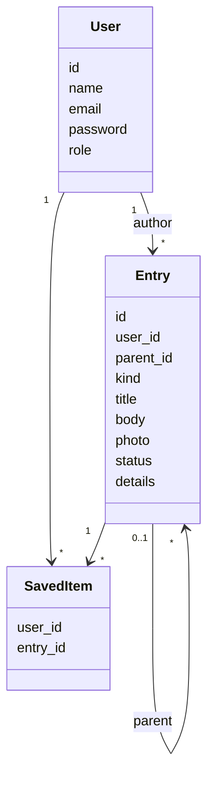

# Initial class diagram

Entry kinds share an author, lifecycle status, and optional parent. The migration enforces parent and author foreign keys. The controller enforces allowed parent kinds and permissions. Examples include a pet update under its pet, a review under its shop, and a sighting under its lost notice. Kind-specific details are stored in the JSON details column.
